# Castle allocation games: optimization report

Automatically generated from `outputs/data/results.json` by `blotto/report.py`. No scenario below is claimed to be the real applicant population; each is a transparent, configurable hypothesis used to stress-test the recommendations.

## Summary

| | Recommendation | Optimized for | Scenario mean | Worst scenario | Most likely alternative |
|---|---|---|---|---|---|
| **Game 1** | **[2, 3, 5, 37, 53]** | robustness (½·mean + ½·worst case, fixed in advance) | 9.05 castle pts | 8.78 (adversarial) | [1, 1, 22, 35, 41] if you believe most applicants are intuitive |
| **Game 2** | **[0, 0, 39, 61, 0]** | the same balanced criterion; also the best scenario mean among finalists | 7.22 payout | 5.86 (adversarial) | [0, 0, 38, 62, 0] (tied at population level); [0, 0, 28, 0, 72] (different structure) |

Every number in this report comes from code that was executed. Game 1 scores are exact against each simulated
population. Game 2 scores are Monte Carlo estimates on 200,000 fresh four-player groups per scenario, with
standard errors of about 0.004–0.008. None of this proves optimality against the real applicant pool. Each result
is optimal or robust **with respect to the seven modeled populations**, and those populations are hypotheses.

## C. Final comparison

### Game 1: recommend [2, 3, 5, 37, 53]

**Why.** It ranks first on the pre-specified balanced criterion on held-out populations. It also lies on the
**exact** mean-vs-worst-case Pareto frontier, computed over all 4,598,126 allocations (see the supplementary
section). It wins 85% of head-to-head matchups against the pooled mixture of all scenarios. The idea is to concede
castle 3 and scrap for castles 1–2 with a token 2–3 soldiers. Then dominate the two most valuable castles: it wins
castle 5 against 92% of opponents and castle 4 against 77%.

**Expected vs robust.** This is a deliberate robustness choice, and the trade-off is sharp:

- **Expected-score optimum:** [1, 1, 22, 35, 41] has the highest scenario mean (9.18). It scores about 11.0
  against intuitive populations (balanced, proportional), but only 7.3–7.4 against strategic and adversarial ones.
- **Robust pick:** [2, 3, 5, 37, 53] gives up 0.13 points of mean to raise the worst case from 7.34 to 8.78.
  Across all seven scenarios it stays within 8.78–9.20.
- **Cheap robustness:** the frontier is steep near the mean optimum. The first 0.11 points of mean you give up
  buy 1.2 points of worst case.

**Sensitivity.**
- Under 2,000 random reweightings of the seven scenarios, it is the top finalist 60% of the time. The next-best finalist reaches
  18%.
- When the populations and strategy pools are re-drawn from scratch with three other seeds, the exact balanced
  optimum moves to [2, 3, 5, 36, 54] or [2, 2, 6, 36, 54], i.e. by 1–2 soldiers. In all three re-draws,
  main-run #8, [2, 3, 5, 36, 54], ranks first.
- Smoothing every opponent's allocation changes its scores by at most 0.16 points (largest change: strategic),
  so it does not depend on tie spikes at round numbers.

**Statistically indistinguishable alternatives.** The ten finalists are all within 0.025 balanced points of each
other, and their order reshuffles when populations are re-drawn. Treat **[2–3, 2–3, 5–6, 36–37, 53–55]** as one
recommendation. The specific vector is the main run's pick.

**Caveat on the adversarial scenario.** If you drop the adversarial scenario (it is built from counters to our
own finalists), a different robust family appears: [1, 12, 1, 40, 46] reaches a worst case of 9.04 over the other
six scenarios. But it falls to 6.7 in the adversarial scenario, so including it is what favors the recommendation.

### Game 2: recommend [0, 0, 39, 61, 0]

**Why.** Win castles 3 and 4 outright (7 of 15 points) and concede castles 1, 2 and 5 entirely.
- **Why 7 points is usually enough:** an opponent can beat 7 only by winning all of castles 1, 2 and 5 (8 points)
  alone.
- **Placement odds:** it finishes first 70% of the time against the pooled mixture. Its distribution is
  70 / 16 / 11 / 3% for first / second / third / fourth.
- **Ranking:** it ranks first among the 25 validated finalists on the balanced criterion and has the best
  scenario mean (7.22).
- **Tailored attack:** an optimizer built an attacker for a field where this allocation is one-third of the
  players. The best counter found was [1, 30, 0, 0, 69], and the pick still earned 7.15 against it.

**How Game 2 changes the strategy.** The payouts are convex (9 for first versus 4 for second), so coming first
matters much more than collecting points. The Game 1 pick played in Game 2 averages only 2.3 against the strategic
population and 4.8 against the broad mixture. Game 2 rewards concentrating on exactly two castles worth 7.

**Statistical status.**
- **Monte Carlo error is small:** the paired, common-random-number comparisons rank the pick above every other
  finalist on the scenario mean, with 95% intervals excluding zero.
- **Population uncertainty is larger:** that precision does not carry over to the population assumptions.
  - Seed re-draws: [0, 0, 39, 61, 0] and [0, 0, 38, 62, 0] swap first and second place.
  - Smoothed opponents: 38/62 edges ahead on the balanced score (6.54 vs 6.52).
  - So **39/61 and 38/62 are indistinguishable at the population level**, and 39/61 keeps the higher mean in
    every check.
- **The exact split is fragile:** the optimizer is partly reacting to how often simulated players put exactly
  38–40 soldiers on castle 3. The robust conclusion is the structure (castles 3+4, roughly 38–40 / 60–62, nothing
  elsewhere), not the last soldier.

**A genuinely different alternative.** [0, 0, 28, 0, 72] (castles 3+5) has a similar scenario mean (7.15). It
ranks first in 41% of random scenario reweightings, versus 30% for the pick. It does better against strategic and
adversarial populations, but collapses against concentrated players (5.6). Choose it if you expect many
computationally optimized applicants and few who stack castles 4 and 5.

### What did not converge, and what was not done

- **Self-play does not converge in either game.**
  - Game 1: fictitious play visited 55–68 distinct best responses in 80 iterations.
  - Game 2: it visited 13 distinct best responses in 13 iterations.
  - This is consistent with Colonel Blotto having no pure-strategy equilibrium. Strong pure allocations are
    always exploitable by a tailored counter: [2, 3, 5, 37, 53] is held to 2.5 points by [2, 0, 6, 38, 54].
- **Seed coverage:**
  - Game 2's per-scenario optimization ran on one optimizer seed. Robustness across seeds was tested by
    re-drawing populations three times.
  - Game 2's seed-stability check reused the computed strategy pools rather than recomputing them.
  - Game 1's stability check recomputed everything.
- **Scope of the Game 1 optimum:** the "exact optimum" claims for Game 1 hold only for the finite simulated
  populations.

## D. Application response (draft)

> **How did you approach each game, and did your strategy change?**
>
> I treated it as an optimization problem under uncertainty about who the other applicants are. I wrote an exact
> scorer for both games and unit-tested every tie case. I then simulated seven very different applicant
> populations: intuitive even or proportional splitters, concentrators, random players, computationally optimized
> players, a broad mix, and an adversarial field built to counter my own finalists. I chose allocations on one set
> of simulated applicants and judged them on a fresh set.
>
> In Game 1, the score against a fixed field adds up castle by castle, so I could compute the exact best response
> to each population. The allocation that maximized the average, [1, 1, 22, 35, 41], was fragile: about 11 points
> against intuitive players, but 7.3 against optimized ones. I chose [2, 3, 5, 37, 53] instead. It concedes
> castle 3, dominates castles 4 and 5, and scored between 8.8 and 9.2 in every population I modeled.
>
> Yes, my strategy changed for Game 2. With payouts of 9/4/2/0, finishing first matters far more than collecting
> points. Winning castles 3 and 4 outright (7 of 15 points) usually beats three opponents who split the rest, so
> I submit [0, 0, 39, 61, 0]. It came first about 70% of the time in simulation and held up against an optimizer
> searching for counters.
>
> I can't prove either allocation is optimal against the real pool. Blotto has no unbeatable pure strategy, and
> my self-play never converged. These are the most robust choices across the scenarios I could model.

## Scenarios

| scenario | description | mixture weights |
|---|---|---|
| balanced | Mostly equal-split and near-equal intuitive allocations. | equal 0.40, noisy_heuristic 0.20, rounded 0.15, dirichlet 0.10, proportional 0.15 |
| proportional | Mostly allocations proportional to castle value, with noise and rounding. | proportional 0.50, noisy_heuristic 0.20, rounded 0.15, equal 0.05, dirichlet 0.10 |
| concentrated | Mostly players who concentrate on a few castles (high, middle or low). | high_value 0.35, middle 0.20, low_value 0.15, dirichlet 0.15, rounded 0.15 |
| random | Mostly uniform-random and Dirichlet-random allocations. | uniform_random 0.50, dirichlet 0.40, noisy_heuristic 0.10 |
| strategic | Mostly computationally optimized players (best responses and self-play outputs). | strategic 0.40, best_response 0.25, self_play 0.20, noisy_heuristic 0.15 |
| broad_mixture | A broad mix of every family; the stated default mixture for averaging. | equal 0.08, proportional 0.12, high_value 0.08, middle 0.06, low_value 0.05, uniform_random 0.08, dirichlet 0.10, noisy_heuristic 0.15, rounded 0.10, strategic 0.08, best_response 0.05, self_play 0.05 |
| adversarial | Half best responses targeting the candidate finalists, plus strategic and simple players. | adversary 0.50, strategic 0.15, noisy_heuristic 0.15, proportional 0.10, equal 0.10 |

Each scenario has 10,000 training and 10,000 independently seeded holdout opponents. Candidates are selected on training populations and reported on holdout ones. The adversarial scenario is rebuilt iteratively from best responses to the current finalists.

## Game 1: head-to-head

### Baseline tournament (25 representative allocations, exact round robin)

| allocation | name | mean pts | win | tie | loss |
|---|---|---|---|---|---|
| [1, 4, 15, 35, 45] | high_tail | 9.708 | 0.88 | 0.04 | 0.08 |
| [0, 0, 20, 35, 45] | top3_heavy | 9.500 | 0.83 | 0.08 | 0.08 |
| [0, 0, 0, 50, 50] | top2_split | 9.167 | 0.92 | 0.00 | 0.08 |
| [3, 3, 24, 32, 38] | c345_odd | 9.021 | 0.75 | 0.00 | 0.25 |
| [0, 30, 35, 35, 0] | middle_three | 8.938 | 0.79 | 0.08 | 0.12 |
| [4, 6, 21, 31, 38] | prop_plus1 | 8.938 | 0.71 | 0.00 | 0.29 |
| [0, 0, 30, 30, 40] | top3_30_30_40 | 8.583 | 0.67 | 0.04 | 0.29 |
| [10, 10, 10, 35, 35] | low_floor | 8.521 | 0.58 | 0.04 | 0.38 |
| [2, 8, 20, 30, 40] | prop_rounded | 8.396 | 0.62 | 0.04 | 0.33 |
| [1, 1, 32, 33, 33] | c345_min | 8.333 | 0.50 | 0.00 | 0.50 |
| [0, 0, 33, 33, 34] | top3_even | 8.271 | 0.46 | 0.12 | 0.42 |
| [0, 0, 34, 0, 66] | c3_c5 | 8.250 | 0.88 | 0.00 | 0.12 |
| [0, 10, 20, 30, 40] | linear_0_40 | 8.229 | 0.58 | 0.04 | 0.38 |
| [11, 11, 11, 33, 34] | tilted_high | 7.771 | 0.42 | 0.04 | 0.54 |
| [5, 10, 20, 30, 35] | prop_skew | 7.646 | 0.50 | 0.04 | 0.46 |
| [0, 15, 25, 25, 35] | mid_high | 7.583 | 0.42 | 0.12 | 0.46 |
| [7, 13, 20, 27, 33] | proportional | 6.500 | 0.29 | 0.04 | 0.67 |
| [20, 30, 50, 0, 0] | low_three | 6.417 | 0.12 | 0.08 | 0.79 |
| [0, 20, 20, 30, 30] | skip_c1_tilt | 6.375 | 0.29 | 0.04 | 0.67 |
| [25, 25, 25, 25, 0] | skip_c5 | 6.271 | 0.17 | 0.04 | 0.79 |
| [0, 25, 25, 25, 25] | skip_c1 | 6.250 | 0.21 | 0.00 | 0.79 |
| [10, 15, 20, 25, 30] | linear_10_30 | 5.854 | 0.21 | 0.00 | 0.79 |
| [0, 0, 0, 0, 100] | all_c5 | 5.833 | 0.12 | 0.00 | 0.88 |
| [20, 20, 20, 20, 20] | equal | 5.208 | 0.12 | 0.00 | 0.88 |
| [100, 0, 0, 0, 0] | all_c1 | 1.938 | 0.00 | 0.00 | 1.00 |

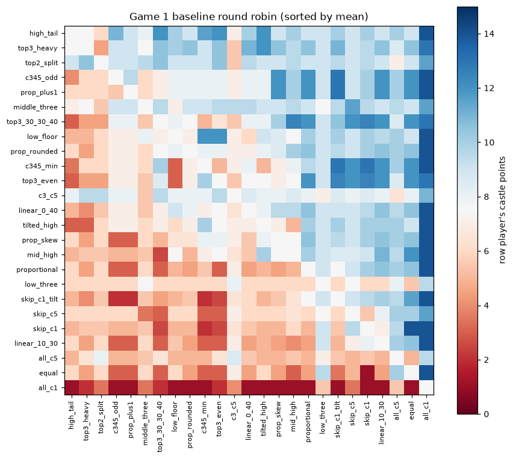

### Exact best response per scenario (training population) and optimizer benchmark

Game 1 scores are additive across castles, so the best response to a finite population is solved **exactly** (knapsack DP, confirmed by enumerating all 4,598,126 allocations). The heuristic optimizers are benchmarked against that exact optimum.

| scenario | exact optimum | train pts | holdout pts | # allocs within 0.05 | max L1 spread | worst gap random | worst gap evo | worst gap local |
|---|---|---|---|---|---|---|---|---|
| balanced | [1, 1, 25, 32, 41] | 11.093 | 11.062 | 34 | 8 | 0.1590 | 0.0000 | 0.0000 |
| proportional | [1, 1, 23, 33, 42] | 11.017 | 10.992 | 36 | 6 | 0.1077 | 0.0000 | 0.0000 |
| concentrated | [1, 11, 36, 51, 1] | 9.521 | 9.552 | 25 | 106 | 0.1223 | 0.0000 | 0.0000 |
| random | [1, 2, 25, 35, 37] | 9.803 | 9.774 | 305 | 12 | 0.0203 | 0.0000 | 0.0000 |
| strategic | [3, 3, 2, 47, 45] | 9.520 | 9.452 | 45 | 94 | 0.1306 | 0.0000 | 0.0000 |
| broad_mixture | [1, 1, 22, 35, 41] | 9.331 | 9.359 | 10 | 42 | 0.0963 | 0.0000 | 0.0000 |

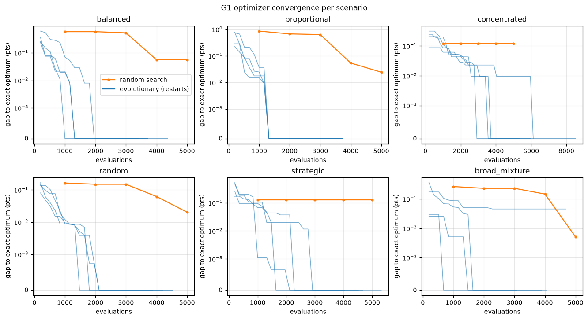

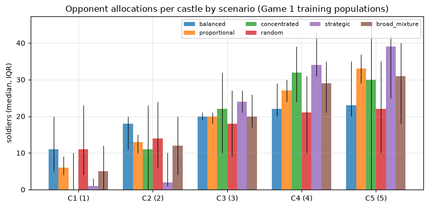

### A. Top 10 Game 1 allocations (holdout populations, all 7 scenarios)

Ranking criterion (fixed before looking at holdout results): **balanced = ½·(equal-weight mean over scenarios) + ½·(worst scenario)**. Scores are exact expected castle points against each finite holdout population (no Monte Carlo error); the uncertainty is about which population is real.

| # | allocation | total | balanced | mean | worst (scenario) | balanced | proportional | concentrated | random | strategic | broad_mixture | adversarial |
|---|---|---|---|---|---|---|---|---|---|---|---|---|
| 1 | [2, 3, 5, 37, 53] | 100 | 8.918 | 9.051 | 8.785 (adversarial) | 9.188 | 9.202 | 8.859 | 9.099 | 9.176 | 9.050 | 8.785 |
| 2 | [2, 2, 5, 37, 54] | 100 | 8.904 | 9.024 | 8.784 (adversarial) | 9.175 | 9.192 | 8.892 | 9.053 | 9.049 | 9.021 | 8.784 |
| 3 | [1, 3, 5, 37, 54] | 100 | 8.903 | 9.011 | 8.795 (adversarial) | 9.159 | 9.174 | 8.892 | 9.064 | 8.989 | 9.001 | 8.795 |
| 4 | [2, 2, 5, 36, 55] | 100 | 8.901 | 8.982 | 8.820 (concentrated) | 9.156 | 9.174 | 8.820 | 9.023 | 8.908 | 8.963 | 8.831 |
| 5 | [2, 2, 6, 37, 53] | 100 | 8.900 | 9.023 | 8.778 (adversarial) | 9.189 | 9.202 | 8.867 | 9.104 | 9.002 | 9.017 | 8.778 |
| 6 | [1, 3, 6, 37, 53] | 100 | 8.899 | 9.010 | 8.788 (adversarial) | 9.173 | 9.184 | 8.867 | 9.116 | 8.942 | 8.997 | 8.788 |
| 7 | [2, 4, 4, 36, 54] | 100 | 8.898 | 9.013 | 8.783 (concentrated) | 9.166 | 9.180 | 8.783 | 9.057 | 9.108 | 9.004 | 8.793 |
| 8 | [2, 3, 5, 36, 54] | 100 | 8.896 | 9.016 | 8.777 (concentrated) | 9.166 | 9.181 | 8.777 | 9.068 | 9.042 | 8.989 | 8.889 |
| 9 | [3, 3, 4, 36, 54] | 100 | 8.895 | 9.018 | 8.771 (concentrated) | 9.175 | 9.202 | 8.771 | 9.041 | 9.134 | 9.012 | 8.795 |
| 10 | [1, 3, 5, 36, 55] | 100 | 8.895 | 8.969 | 8.820 (concentrated) | 9.140 | 9.157 | 8.820 | 9.034 | 8.849 | 8.943 | 8.841 |

| # | allocation | main strengths | main vulnerabilities |
|---|---|---|---|
| 1 | [2, 3, 5, 37, 53] | best in 'proportional' (9.202); wins C5 92%, C4 77% of the time | weakest in 'adversarial' (8.785); lowest vs family 'self_play' (6.04); a tailored counter holds it to 2.50 pts |
| 2 | [2, 2, 5, 37, 54] | best in 'proportional' (9.192); wins C5 93%, C4 77% of the time | weakest in 'adversarial' (8.784); lowest vs family 'self_play' (6.06); a tailored counter holds it to 3.00 pts |
| 3 | [1, 3, 5, 37, 54] | best in 'proportional' (9.174); wins C5 93%, C4 77% of the time | weakest in 'adversarial' (8.795); lowest vs family 'self_play' (6.01); a tailored counter holds it to 2.50 pts |
| 4 | [2, 2, 5, 36, 55] | best in 'proportional' (9.174); wins C5 94%, C4 75% of the time | weakest in 'concentrated' (8.820); lowest vs family 'self_play' (6.10); a tailored counter holds it to 3.00 pts |
| 5 | [2, 2, 6, 37, 53] | best in 'proportional' (9.202); wins C5 92%, C4 77% of the time | weakest in 'adversarial' (8.778); lowest vs family 'self_play' (5.98); a tailored counter holds it to 3.00 pts |
| 6 | [1, 3, 6, 37, 53] | best in 'proportional' (9.184); wins C5 92%, C4 77% of the time | weakest in 'adversarial' (8.788); lowest vs family 'self_play' (5.93); a tailored counter holds it to 2.50 pts |
| 7 | [2, 4, 4, 36, 54] | best in 'proportional' (9.180); wins C5 93%, C4 75% of the time | weakest in 'concentrated' (8.783); lowest vs family 'self_play' (6.08); a tailored counter holds it to 2.00 pts |
| 8 | [2, 3, 5, 36, 54] | best in 'proportional' (9.181); wins C5 93%, C4 75% of the time | weakest in 'concentrated' (8.777); lowest vs family 'self_play' (6.09); a tailored counter holds it to 2.50 pts |
| 9 | [3, 3, 4, 36, 54] | best in 'proportional' (9.202); wins C5 93%, C4 75% of the time | weakest in 'concentrated' (8.771); lowest vs family 'self_play' (6.16); a tailored counter holds it to 2.00 pts |
| 10 | [1, 3, 5, 36, 55] | best in 'proportional' (9.157); wins C5 94%, C4 75% of the time | weakest in 'concentrated' (8.820); lowest vs family 'self_play' (6.06); a tailored counter holds it to 2.50 pts |

Per-castle win/tie rates against the pooled stated mixture:

| # | allocation | C1 win/tie | C2 win/tie | C3 win/tie | C4 win/tie | C5 win/tie |
|---|---|---|---|---|---|---|
| 1 | [2, 3, 5, 37, 53] | 0.32/0.07 | 0.25/0.03 | 0.14/0.02 | 0.77/0.01 | 0.92/0.01 |
| 2 | [2, 2, 5, 37, 54] | 0.32/0.07 | 0.21/0.04 | 0.14/0.02 | 0.77/0.01 | 0.93/0.01 |
| 3 | [1, 3, 5, 37, 54] | 0.22/0.10 | 0.25/0.03 | 0.14/0.02 | 0.77/0.01 | 0.93/0.01 |
| 4 | [2, 2, 5, 36, 55] | 0.32/0.07 | 0.21/0.04 | 0.14/0.02 | 0.75/0.02 | 0.94/0.01 |
| 5 | [2, 2, 6, 37, 53] | 0.32/0.07 | 0.21/0.04 | 0.15/0.01 | 0.77/0.01 | 0.92/0.01 |

Mean points by opponent family (pooled stated mixture):

| # | allocation | adversary | best_response | dirichlet | equal | high_value | low_value | middle | noisy_heuristic | proportional | rounded | self_play | strategic | uniform_random |
|---|---|---|---|---|---|---|---|---|---|---|---|---|---|---|
| 1 | [2, 3, 5, 37, 53] | 7.94 | 9.53 | 9.01 | 9.00 | 9.43 | 7.89 | 8.19 | 9.76 | 9.00 | 9.21 | 6.04 | 10.30 | 9.07 |
| 2 | [2, 2, 5, 37, 54] | 8.04 | 9.44 | 8.98 | 9.00 | 9.54 | 7.89 | 8.19 | 9.72 | 9.00 | 9.21 | 6.06 | 10.04 | 9.01 |
| 3 | [1, 3, 5, 37, 54] | 8.09 | 9.31 | 8.98 | 9.00 | 9.54 | 7.89 | 8.19 | 9.64 | 9.00 | 9.21 | 6.01 | 10.02 | 9.05 |
| 4 | [2, 2, 5, 36, 55] | 8.22 | 9.24 | 8.95 | 9.00 | 9.49 | 7.78 | 8.00 | 9.63 | 9.00 | 9.24 | 6.10 | 9.82 | 8.99 |
| 5 | [2, 2, 6, 37, 53] | 8.04 | 9.43 | 9.02 | 9.00 | 9.43 | 7.89 | 8.19 | 9.72 | 9.00 | 9.26 | 5.98 | 9.97 | 9.09 |

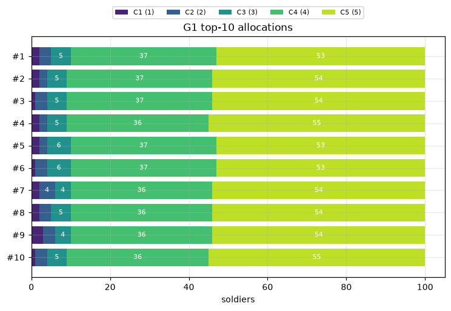

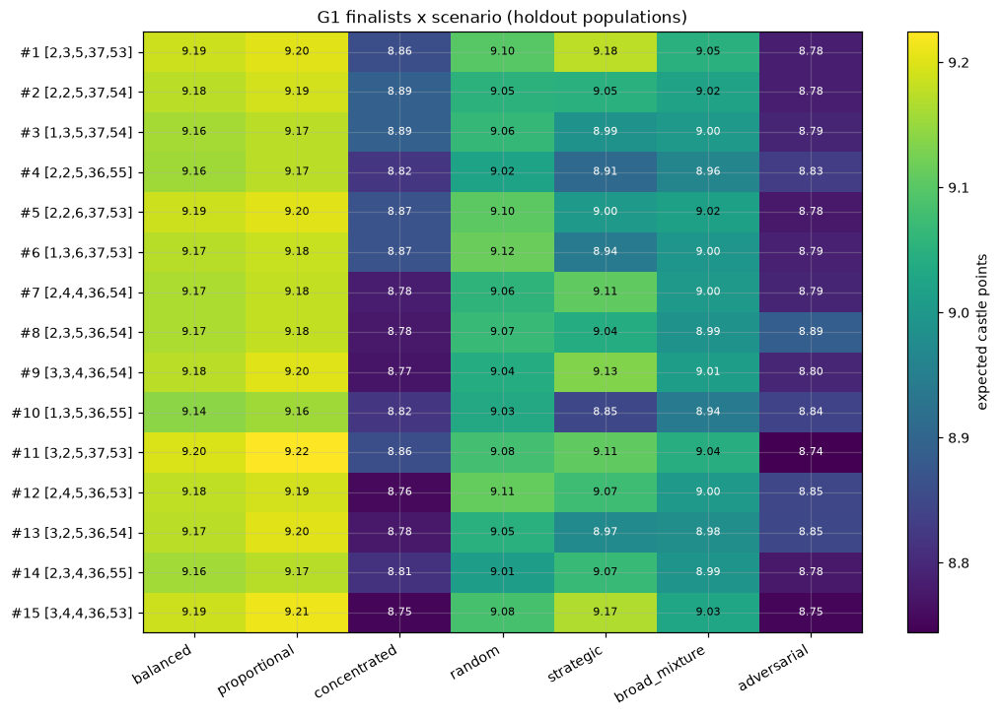

### Robustness

Exact optimum of each criterion over **all** allocations on the holdout populations: mean: [1, 1, 22, 35, 41]; maximin: [2, 2, 5, 36, 55]; balanced: [2, 3, 5, 37, 53]

Sensitivity to scenario weights (2,000 Dirichlet(1) weightings; exact because Game 1 is linear in the mixture):

| # | allocation | p10 score | p90 score | ranked #1 in | mean rank |
|---|---|---|---|---|---|
| 1 | [2, 3, 5, 37, 53] | 8.975 | 9.119 | 60% | 1.9 |
| 2 | [2, 2, 5, 37, 54] | 8.959 | 9.085 | 1% | 8.3 |
| 3 | [1, 3, 5, 37, 54] | 8.951 | 9.068 | 0% | 12.9 |
| 4 | [2, 2, 5, 36, 55] | 8.920 | 9.046 | 0% | 20.7 |
| 5 | [2, 2, 6, 37, 53] | 8.951 | 9.088 | 0% | 7.9 |
| 6 | [1, 3, 6, 37, 53] | 8.941 | 9.074 | 0% | 12.5 |
| 7 | [2, 4, 4, 36, 54] | 8.938 | 9.081 | 0% | 13.4 |
| 8 | [2, 3, 5, 36, 54] | 8.953 | 9.076 | 4% | 10.8 |
| 9 | [3, 3, 4, 36, 54] | 8.941 | 9.090 | 0% | 11.2 |
| 10 | [1, 3, 5, 36, 55] | 8.907 | 9.033 | 0% | 23.6 |

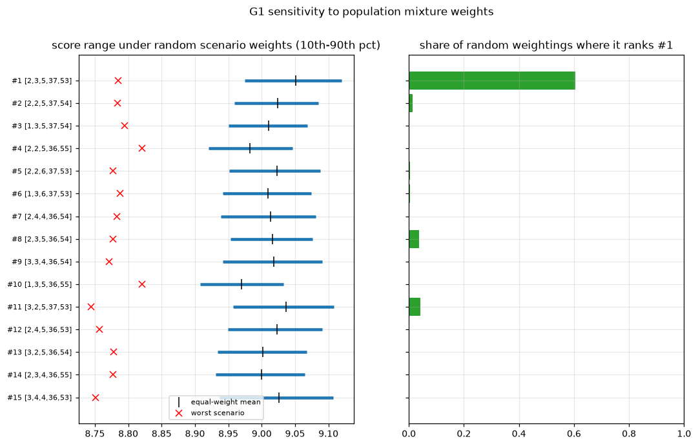

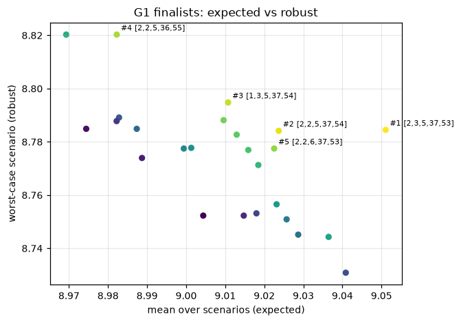

Exploitability: every pure allocation can be crushed by a counter tailored to it. [2, 3, 5, 37, 53] is held to 2.5 by [2, 0, 6, 38, 54]; [2, 2, 5, 37, 54] is held to 3.0 by [0, 0, 6, 38, 56]; [1, 3, 5, 37, 54] is held to 2.5 by [1, 0, 6, 38, 55]. The adversarial scenario measures the realistic version (a minority of counter-strategies mixed into a population).

Seed stability (populations and strategy pools re-drawn from scratch):

| population seed | main-run finalists ordered by score under this seed (main-run rank numbers) |
|---|---|
| 11 | 8 1 5 4 2 6 3 9 7 10 |
| 23 | 8 5 1 2 6 4 3 10 9 7 |
| 37 | 8 2 1 5 3 6 9 7 4 10 |

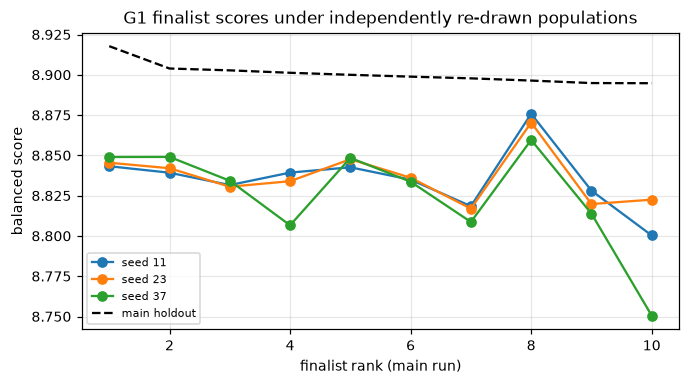

### Self-play

| run | iterations | distinct BRs | revisits | distinct in 2nd half | verdict | last BR |
|---|---|---|---|---|---|---|
| anchor_0.0 | 80 | 68 | 12 | 31 | wandering (no fixed point within the iteration budget) | [11, 24, 20, 32, 13] |
| anchor_0.5 | 80 | 55 | 25 | 24 | wandering (no fixed point within the iteration budget) | [10, 6, 41, 16, 27] |

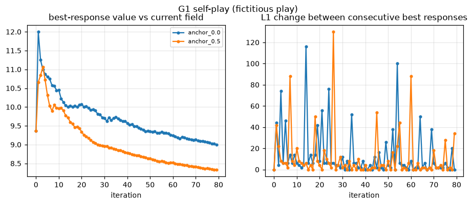

## Game 2: four-way battle

### Baseline tournament (exact: each baseline vs every triple of the other 24)

| allocation | name | mean payout | P(1st/2nd/3rd/4th) | castle pts |
|---|---|---|---|---|
| [0, 0, 0, 50, 50] | top2_split | 7.624 | 0.76 / 0.15 / 0.09 / 0.00 | 7.82 |
| [0, 30, 35, 35, 0] | middle_three | 7.421 | 0.71 / 0.23 / 0.06 / 0.00 | 7.37 |
| [0, 0, 34, 0, 66] | c3_c5 | 7.039 | 0.68 / 0.20 / 0.09 / 0.04 | 6.68 |
| [0, 0, 20, 35, 45] | top3_heavy | 6.163 | 0.57 / 0.19 / 0.12 / 0.11 | 6.11 |
| [1, 4, 15, 35, 45] | high_tail | 6.137 | 0.57 / 0.19 / 0.12 / 0.12 | 6.10 |
| [20, 30, 50, 0, 0] | low_three | 6.020 | 0.42 / 0.53 / 0.04 / 0.00 | 5.59 |
| [0, 0, 0, 0, 100] | all_c5 | 5.921 | 0.39 / 0.60 / 0.01 / 0.00 | 5.02 |
| [0, 0, 33, 33, 34] | top3_even | 4.325 | 0.30 / 0.30 / 0.23 / 0.18 | 3.97 |
| [10, 10, 10, 35, 35] | low_floor | 4.179 | 0.25 / 0.33 / 0.32 / 0.10 | 4.30 |
| [0, 0, 30, 30, 40] | top3_30_30_40 | 4.062 | 0.27 / 0.32 / 0.17 / 0.24 | 3.94 |
| [1, 1, 32, 33, 33] | c345_min | 3.878 | 0.26 / 0.26 / 0.25 / 0.23 | 3.62 |
| [25, 25, 25, 25, 0] | skip_c5 | 3.282 | 0.11 / 0.35 / 0.44 / 0.10 | 3.37 |
| [3, 3, 24, 32, 38] | c345_odd | 3.188 | 0.18 / 0.28 / 0.22 / 0.32 | 3.27 |
| [4, 6, 21, 31, 38] | prop_plus1 | 2.887 | 0.15 / 0.27 / 0.24 / 0.34 | 3.04 |
| [0, 10, 20, 30, 40] | linear_0_40 | 2.860 | 0.14 / 0.29 / 0.22 / 0.35 | 2.97 |
| [2, 8, 20, 30, 40] | prop_rounded | 2.836 | 0.14 / 0.29 / 0.22 / 0.35 | 2.97 |
| [11, 11, 11, 33, 34] | tilted_high | 2.696 | 0.10 / 0.26 / 0.37 / 0.27 | 2.99 |
| [0, 15, 25, 25, 35] | mid_high | 2.415 | 0.09 / 0.25 / 0.31 / 0.35 | 2.55 |
| [0, 25, 25, 25, 25] | skip_c1 | 2.372 | 0.06 / 0.27 / 0.38 / 0.29 | 2.53 |
| [20, 20, 20, 20, 20] | equal | 1.825 | 0.01 / 0.18 / 0.52 / 0.29 | 1.95 |
| [5, 10, 20, 30, 35] | prop_skew | 1.749 | 0.06 / 0.14 / 0.33 / 0.47 | 1.92 |
| [0, 20, 20, 30, 30] | skip_c1_tilt | 1.618 | 0.02 / 0.14 / 0.42 / 0.41 | 1.76 |
| [10, 15, 20, 25, 30] | linear_10_30 | 1.324 | 0.01 / 0.10 / 0.41 / 0.47 | 1.49 |
| [7, 13, 20, 27, 33] | proportional | 1.247 | 0.02 / 0.10 / 0.33 / 0.55 | 1.41 |
| [100, 0, 0, 0, 0] | all_c1 | 0.687 | 0.00 / 0.00 / 0.34 / 0.66 | 1.01 |

### Best response per scenario

Optimized on a fixed training field (common random numbers), then re-scored on fresh groups from the independent holdout population (95% CI shown).

| scenario | best found | train payout | holdout payout (95% CI) |
|---|---|---|---|
| balanced | [0, 0, 40, 0, 60] | 8.695 | 8.733 ± 0.011 |
| proportional | [0, 0, 40, 0, 60] | 8.707 | 8.718 ± 0.011 |
| concentrated | [0, 41, 0, 59, 0] | 8.014 | 8.004 ± 0.019 |
| random | [0, 0, 0, 41, 59] | 7.455 | 7.565 ± 0.022 |
| strategic | [14, 13, 2, 0, 71] | 8.057 | 8.115 ± 0.014 |
| broad_mixture | [0, 0, 40, 60, 0] | 7.523 | 7.528 ± 0.023 |

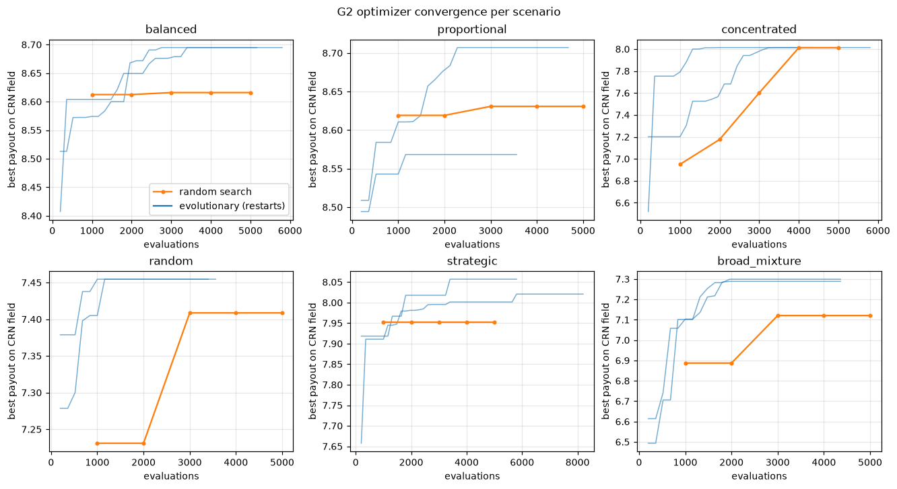

### B. Top 10 Game 2 allocations (holdout populations, all 7 scenarios)

Validated with 200,000 fresh four-player groups per scenario (248 candidates screened first). Same balanced criterion as Game 1. Placement probabilities are against the pooled stated mixture.

| # | allocation | total | balanced | mean | worst (scenario) | balanced | proportional | concentrated | random | strategic | broad_mixture | adversarial | P(1st/2nd/3rd/4th) |
|---|---|---|---|---|---|---|---|---|---|---|---|---|---|
| 1 | [0, 0, 39, 61, 0] | 100 | 6.539 | 7.223 | 5.855 (adversarial) | 8.393 | 8.402 | 7.325 | 6.558 | 6.554 | 7.470 | 5.855 | 0.70 / 0.15 / 0.11 / 0.03 |
| 2 | [0, 0, 38, 62, 0] | 100 | 6.533 | 7.112 | 5.953 (adversarial) | 8.396 | 8.400 | 7.200 | 6.508 | 6.063 | 7.266 | 5.953 | 0.67 / 0.18 / 0.11 / 0.03 |
| 3 | [0, 1, 37, 62, 0] | 100 | 6.448 | 7.024 | 5.873 (strategic) | 8.386 | 8.390 | 7.103 | 6.426 | 5.873 | 7.099 | 5.892 | 0.65 / 0.21 / 0.11 / 0.03 |
| 4 | [1, 2, 35, 62, 0] | 100 | 6.431 | 6.938 | 5.925 (strategic) | 8.348 | 8.357 | 6.777 | 6.273 | 5.925 | 6.893 | 5.994 | 0.62 / 0.23 / 0.12 / 0.04 |
| 5 | [2, 1, 35, 62, 0] | 100 | 6.430 | 6.937 | 5.923 (strategic) | 8.349 | 8.358 | 6.779 | 6.274 | 5.923 | 6.906 | 5.968 | 0.62 / 0.23 / 0.12 / 0.04 |
| 6 | [0, 2, 36, 62, 0] | 100 | 6.411 | 6.968 | 5.853 (strategic) | 8.375 | 8.384 | 6.915 | 6.351 | 5.853 | 6.974 | 5.927 | 0.63 / 0.22 / 0.11 / 0.04 |
| 7 | [1, 0, 38, 61, 0] | 100 | 6.410 | 7.094 | 5.725 (adversarial) | 8.390 | 8.395 | 7.307 | 6.483 | 6.092 | 7.267 | 5.725 | 0.66 / 0.19 / 0.11 / 0.03 |
| 8 | [0, 1, 38, 61, 0] | 100 | 6.409 | 7.101 | 5.717 (adversarial) | 8.389 | 8.394 | 7.227 | 6.483 | 6.240 | 7.255 | 5.717 | 0.66 / 0.19 / 0.11 / 0.04 |
| 9 | [1, 1, 36, 62, 0] | 100 | 6.392 | 6.980 | 5.803 (strategic) | 8.377 | 8.385 | 7.037 | 6.350 | 5.803 | 6.991 | 5.920 | 0.63 / 0.22 / 0.11 / 0.04 |
| 10 | [0, 0, 28, 0, 72] | 100 | 6.388 | 7.157 | 5.619 (concentrated) | 8.461 | 8.378 | 5.619 | 7.174 | 7.178 | 6.961 | 6.326 | 0.65 / 0.26 / 0.04 / 0.04 |

| # | allocation | main strengths | main vulnerabilities |
|---|---|---|---|
| 1 | [0, 0, 39, 61, 0] | best in 'proportional' (8.402); wins C4 88%, C3 84% of the time | weakest in 'adversarial' (5.855); lowest vs family 'adversary' (4.47); concedes C1, C2, C5 |
| 2 | [0, 0, 38, 62, 0] | best in 'proportional' (8.400); wins C4 89%, C3 79% of the time | weakest in 'adversarial' (5.953); lowest vs family 'adversary' (4.77); concedes C1, C2, C5 |
| 3 | [0, 1, 37, 62, 0] | best in 'proportional' (8.390); wins C4 89%, C3 76% of the time | weakest in 'strategic' (5.873); lowest vs family 'adversary' (4.82); concedes C1, C5 |
| 4 | [1, 2, 35, 62, 0] | best in 'proportional' (8.357); wins C4 89%, C3 71% of the time | weakest in 'strategic' (5.925); lowest vs family 'adversary' (5.17); concedes C5 |
| 5 | [2, 1, 35, 62, 0] | best in 'proportional' (8.358); wins C4 89%, C3 71% of the time | weakest in 'strategic' (5.923); lowest vs family 'adversary' (5.04); concedes C5 |
| 6 | [0, 2, 36, 62, 0] | best in 'proportional' (8.384); wins C4 89%, C3 73% of the time | weakest in 'strategic' (5.853); lowest vs family 'best_response' (4.92); concedes C1, C5 |
| 7 | [1, 0, 38, 61, 0] | best in 'proportional' (8.395); wins C4 88%, C3 79% of the time | weakest in 'adversarial' (5.725); lowest vs family 'adversary' (4.53); concedes C2, C5 |
| 8 | [0, 1, 38, 61, 0] | best in 'proportional' (8.394); wins C4 88%, C3 79% of the time | weakest in 'adversarial' (5.717); lowest vs family 'adversary' (4.52); concedes C1, C5 |
| 9 | [1, 1, 36, 62, 0] | best in 'proportional' (8.385); wins C4 89%, C3 73% of the time | weakest in 'strategic' (5.803); lowest vs family 'adversary' (4.92); concedes C5 |
| 10 | [0, 0, 28, 0, 72] | best in 'balanced' (8.461); wins C5 92%, C3 53% of the time | weakest in 'concentrated' (5.619); lowest vs family 'adversary' (4.89); concedes C1, C2, C4 |

Paired (common-random-number) comparison vs #1 on the equal-weight scenario mean:

| # | allocation | diff vs #1 | 95% CI | verdict |
|---|---|---|---|---|
| 1 | [0, 0, 39, 61, 0] | +0.0000 | [+0.0000, +0.0000] | reference |
| 2 | [0, 0, 38, 62, 0] | -0.1104 | [-0.1121, -0.1086] | worse |
| 3 | [0, 1, 37, 62, 0] | -0.1983 | [-0.2006, -0.1961] | worse |
| 4 | [1, 2, 35, 62, 0] | -0.2846 | [-0.2874, -0.2817] | worse |
| 5 | [2, 1, 35, 62, 0] | -0.2859 | [-0.2887, -0.2831] | worse |
| 6 | [0, 2, 36, 62, 0] | -0.2541 | [-0.2566, -0.2516] | worse |
| 7 | [1, 0, 38, 61, 0] | -0.1285 | [-0.1300, -0.1269] | worse |
| 8 | [0, 1, 38, 61, 0] | -0.1219 | [-0.1235, -0.1203] | worse |
| 9 | [1, 1, 36, 62, 0] | -0.2423 | [-0.2448, -0.2397] | worse |
| 10 | [0, 0, 28, 0, 72] | -0.0658 | [-0.0717, -0.0599] | worse |

These intervals capture **Monte Carlo** error only. They do not capture uncertainty about the population itself; the seed-stability table below is the better guide to that.

Per-castle outright win/tie rates (stated mixture):

| # | allocation | C1 win/tie | C2 win/tie | C3 win/tie | C4 win/tie | C5 win/tie |
|---|---|---|---|---|---|---|
| 1 | [0, 0, 39, 61, 0] | 0.00/0.02 | 0.00/0.01 | 0.84/0.02 | 0.88/0.02 | 0.00/0.00 |
| 2 | [0, 0, 38, 62, 0] | 0.00/0.02 | 0.00/0.01 | 0.79/0.05 | 0.89/0.01 | 0.00/0.00 |
| 3 | [0, 1, 37, 62, 0] | 0.00/0.02 | 0.01/0.01 | 0.76/0.03 | 0.89/0.01 | 0.00/0.00 |
| 4 | [1, 2, 35, 62, 0] | 0.02/0.03 | 0.01/0.00 | 0.71/0.02 | 0.89/0.01 | 0.00/0.00 |
| 5 | [2, 1, 35, 62, 0] | 0.05/0.02 | 0.01/0.01 | 0.71/0.02 | 0.89/0.01 | 0.00/0.00 |

Mean payout by opponent family (groups drawn entirely from that family):

| # | allocation | adversary | best_response | dirichlet | equal | high_value | low_value | middle | noisy_heuristic | proportional | rounded | self_play | strategic | uniform_random |
|---|---|---|---|---|---|---|---|---|---|---|---|---|---|---|
| 1 | [0, 0, 39, 61, 0] | 4.47 | 5.52 | 6.40 | 8.70 | 8.53 | 7.90 | 7.20 | 8.88 | 8.88 | 7.79 | 6.08 | 7.39 | 6.32 |
| 2 | [0, 0, 38, 62, 0] | 4.77 | 5.22 | 6.37 | 8.70 | 8.53 | 7.83 | 7.06 | 8.88 | 8.88 | 7.79 | 5.91 | 6.45 | 6.26 |
| 3 | [0, 1, 37, 62, 0] | 4.82 | 5.34 | 6.30 | 8.70 | 8.55 | 7.75 | 6.89 | 8.88 | 8.88 | 7.80 | 5.85 | 6.29 | 6.16 |
| 4 | [1, 2, 35, 62, 0] | 5.17 | 5.26 | 6.14 | 8.70 | 8.73 | 7.52 | 6.34 | 8.87 | 8.88 | 7.73 | 6.05 | 6.49 | 5.98 |
| 5 | [2, 1, 35, 62, 0] | 5.04 | 5.23 | 6.14 | 8.70 | 8.73 | 7.52 | 6.34 | 8.87 | 8.88 | 7.73 | 6.01 | 6.46 | 5.98 |

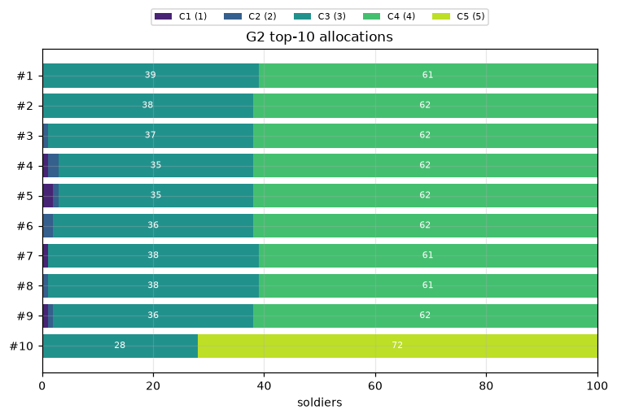

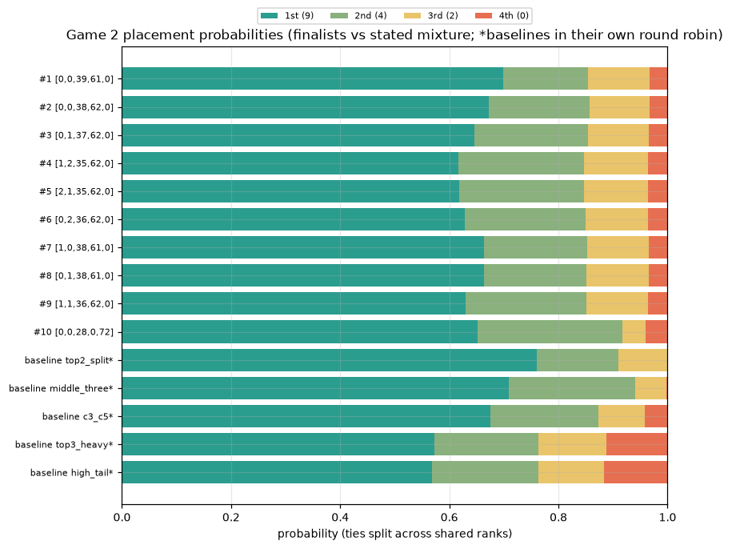

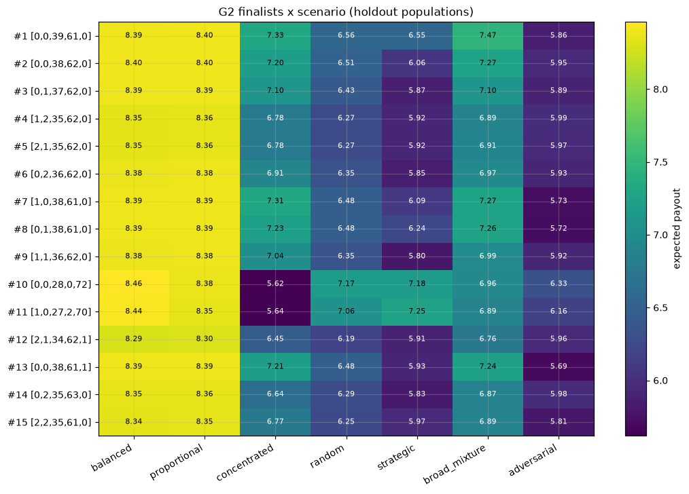

### Robustness

Sensitivity: 25 finalists re-simulated under random Dirichlet(1) scenario weightings (mixed populations re-sampled each draw):

| # | allocation | p10 score | p90 score | ranked #1 in | mean rank |
|---|---|---|---|---|---|
| 1 | [0, 0, 39, 61, 0] | 6.757 | 7.543 | 30% | 2.2 |
| 2 | [0, 0, 38, 62, 0] | 6.641 | 7.430 | 0% | 4.0 |
| 3 | [0, 1, 37, 62, 0] | 6.489 | 7.318 | 0% | 9.0 |
| 4 | [1, 2, 35, 62, 0] | 6.342 | 7.181 | 0% | 19.2 |
| 5 | [2, 1, 35, 62, 0] | 6.341 | 7.187 | 0% | 18.3 |
| 6 | [0, 2, 36, 62, 0] | 6.394 | 7.257 | 0% | 14.7 |
| 7 | [1, 0, 38, 61, 0] | 6.564 | 7.397 | 0% | 5.8 |
| 8 | [0, 1, 38, 61, 0] | 6.577 | 7.394 | 0% | 6.5 |
| 9 | [1, 1, 36, 62, 0] | 6.410 | 7.264 | 0% | 13.4 |
| 10 | [0, 0, 28, 0, 72] | 6.644 | 7.499 | 40% | 6.9 |

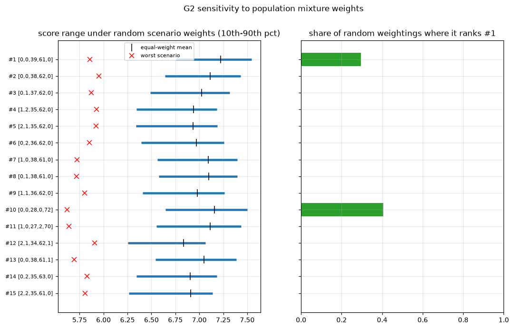

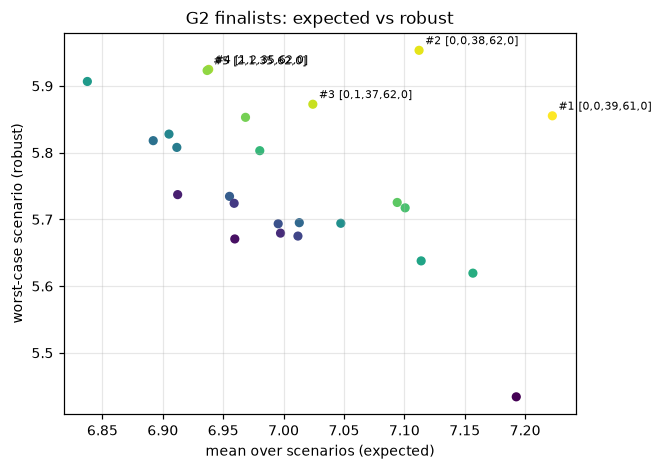

Targeted exploitation (an optimizer attacks a field where the finalist is one third of players; the finalist is then scored in a field where that attacker is one third):

| finalist | attacker found | finalist payout vs attacker-heavy field |
|---|---|---|
| [0, 0, 39, 61, 0] | [1, 30, 0, 0, 69] | 7.154 ± 0.020 |
| [0, 0, 38, 62, 0] | [1, 28, 0, 0, 71] | 7.145 ± 0.020 |
| [0, 1, 37, 62, 0] | [1, 30, 0, 0, 69] | 7.134 ± 0.020 |
| [1, 2, 35, 62, 0] | [2, 28, 0, 0, 70] | 6.873 ± 0.021 |
| [2, 1, 35, 62, 0] | [0, 1, 36, 0, 63] | 5.570 ± 0.022 |

Seed stability (populations re-drawn; computed pools reused):

| population seed | main-run finalists ordered by score under this seed (main-run rank numbers) |
|---|---|
| 11 | 1 2 8 7 3 4 5 6 9 10 |
| 23 | 2 1 7 8 3 5 4 6 9 10 |
| 37 | 1 2 3 5 4 7 8 6 9 10 |

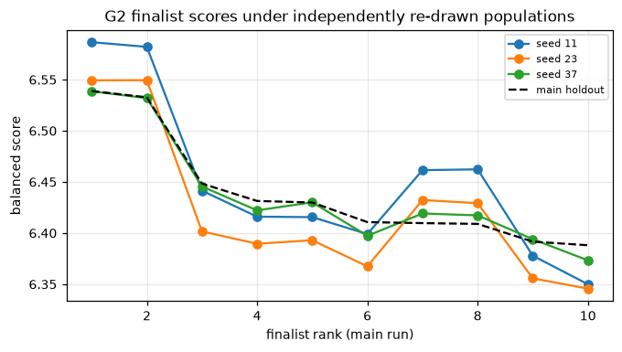

### Self-play

| run | iterations | distinct BRs | revisits | distinct in 2nd half | verdict | last BR |
|---|---|---|---|---|---|---|
| anchor_0.0 | 13 | 13 | 0 | 7 | wandering (no fixed point within the iteration budget) | [7, 5, 40, 34, 14] |
| anchor_0.5 | 13 | 13 | 0 | 7 | wandering (no fixed point within the iteration budget) | [0, 1, 35, 64, 0] |

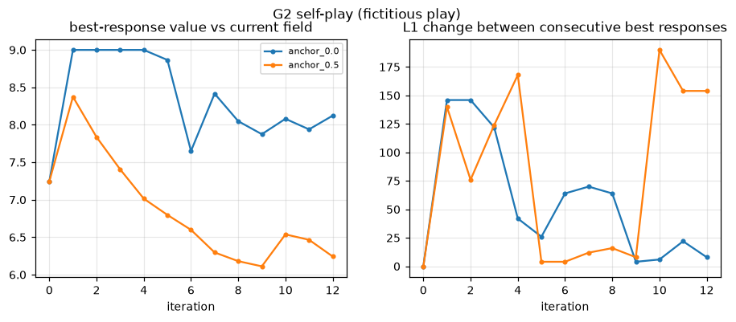

## Strategic analysis

### Castle 1: sacrifice or contest? (Game 1, exact constrained optima, holdout)

| scenario | best with C1 = 0 | best with C1 > 0 |
|---|---|---|
| balanced | [0, 1, 23, 35, 41] 11.057 | [1, 0, 23, 35, 41] 11.070 |
| proportional | [0, 1, 23, 35, 41] 10.984 | [1, 0, 23, 35, 41] 10.992 |
| concentrated | [0, 11, 37, 51, 1] 9.318 | [1, 11, 36, 51, 1] 9.552 |
| random | [0, 2, 25, 35, 38] 9.761 | [1, 2, 25, 35, 37] 9.774 |
| strategic | [0, 3, 2, 51, 44] 9.099 | [3, 15, 29, 0, 53] 9.463 |
| broad_mixture | [0, 1, 22, 36, 41] 9.325 | [1, 1, 22, 35, 41] 9.359 |
| adversarial | [0, 15, 26, 2, 57] 9.338 | [5, 13, 26, 0, 56] 9.642 |

### Number of castles contested (Game 1, exact best with exactly k nonzero castles)

| scenario | k=1 | k=2 | k=3 | k=4 | k=5 |
|---|---|---|---|---|---|
| balanced | [0, 0, 0, 0, 100] 5.18 | [0, 0, 0, 49, 51] 8.97 | [0, 0, 23, 36, 41] 11.05 | [1, 0, 23, 35, 41] 11.07 | [1, 1, 25, 32, 41] 11.06 |
| proportional | [0, 0, 0, 0, 100] 5.18 | [0, 0, 0, 49, 51] 8.98 | [0, 0, 23, 36, 41] 10.98 | [1, 0, 23, 35, 41] 10.99 | [1, 1, 23, 33, 42] 10.99 |
| concentrated | [0, 0, 0, 0, 100] 5.90 | [0, 0, 0, 47, 53] 8.82 | [0, 1, 0, 46, 53] 9.10 | [1, 1, 0, 46, 52] 9.33 | [1, 11, 36, 51, 1] 9.55 |
| random | [0, 0, 0, 0, 100] 5.27 | [0, 0, 0, 47, 53] 8.56 | [0, 0, 25, 36, 39] 9.72 | [0, 2, 25, 35, 38] 9.76 | [1, 2, 25, 35, 37] 9.77 |
| strategic | [0, 0, 0, 0, 100] 5.34 | [0, 0, 0, 54, 46] 8.42 | [0, 4, 0, 52, 44] 9.07 | [3, 15, 29, 0, 53] 9.46 | [3, 4, 2, 46, 45] 9.46 |
| broad_mixture | [0, 0, 0, 0, 100] 5.40 | [0, 0, 0, 48, 52] 8.70 | [0, 0, 22, 36, 42] 9.26 | [0, 1, 22, 36, 41] 9.32 | [1, 1, 22, 35, 41] 9.36 |
| adversarial | [0, 0, 0, 0, 100] 5.34 | [0, 0, 0, 46, 54] 8.53 | [0, 15, 26, 0, 59] 9.33 | [5, 13, 26, 0, 56] 9.64 | [5, 13, 25, 1, 56] 9.62 |

### Castle prices: how contested is each castle? (C1/…/C5)

| scenario | mean opponent soldiers | soldiers to beat 80% of opponents | points per soldier at 80% win rate |
|---|---|---|---|
| balanced | 13 / 16 / 20 / 25 / 27 | 21 / 21 / 22 / 31 / 37 | 0.038 / 0.076 / 0.109 / 0.103 / 0.108 |
| proportional | 8 / 13 / 20 / 27 / 32 | 11 / 17 / 22 / 31 / 39 | 0.073 / 0.094 / 0.109 / 0.103 / 0.103 |
| concentrated | 6 / 14 / 22 / 31 / 27 | 12 / 26 / 35 / 41 / 49 | 0.067 / 0.062 / 0.069 / 0.078 / 0.082 |
| random | 16 / 18 / 20 / 22 / 25 | 28 / 29 / 31 / 34 / 39 | 0.029 / 0.055 / 0.077 / 0.094 / 0.103 |
| strategic | 3 / 6 / 23 / 35 / 34 | 5 / 13 / 30 / 47 / 45 | 0.160 / 0.123 / 0.080 / 0.068 / 0.089 |
| broad_mixture | 8 / 13 / 21 / 28 / 29 | 17 / 21 / 30 / 38 / 42 | 0.047 / 0.076 / 0.080 / 0.084 / 0.095 |
| adversarial | 6 / 7 / 13 / 32 / 42 | 11 / 15 / 22 / 44 / 53 | 0.073 / 0.107 / 0.109 / 0.073 / 0.075 |

### Are there many near-equivalent allocations? (Game 1)

| scenario | # within 0.05 pts of optimum | # within 0.10 | max L1 distance among the 0.05 set |
|---|---|---|---|
| balanced | 33 | 118 | 8 |
| proportional | 40 | 104 | 8 |
| concentrated | 15 | 139 | 104 |
| random | 332 | 1145 | 10 |
| strategic | 184 | 940 | 96 |
| broad_mixture | 11 | 78 | 42 |
| adversarial | 55 | 391 | 6 |

### Predictability (Game 1): score of each allocation against its own tailored counter

| allocation | vector | score vs tailored counter |
|---|---|---|
| proportional | [7, 13, 20, 27, 33] | 1.0 |
| equal | [20, 20, 20, 20, 20] | 1.0 |
| linear_0_40 | [0, 10, 20, 30, 40] | 2.0 |
| pick | [2, 3, 5, 37, 53] | 2.5 |

### Does the Game 1 pick exploit artifacts of the simulated populations?

Each population is smoothed by moving a few random soldiers per opponent (destroying spikes at round numbers); a large drop would mean the pick relies on exact tie patterns.

| scenario | pick | pick (smoothed pop) | optimum | optimum (smoothed) | opp. entries on multiples of 5 |
|---|---|---|---|---|---|
| balanced | 9.188 | 9.175 | 11.070 | 10.991 | 52% |
| proportional | 9.202 | 9.199 | 10.992 | 10.914 | 38% |
| concentrated | 8.859 | 8.876 | 9.552 | 9.427 | 59% |
| random | 9.099 | 9.079 | 9.774 | 9.756 | 24% |
| strategic | 9.176 | 9.017 | 9.463 | 9.443 | 24% |
| broad_mixture | 9.050 | 9.026 | 9.359 | 9.262 | 41% |
| adversarial | 8.785 | 8.729 | 9.642 | 9.607 | 28% |

### Game 2 structure

- Correlation between expected castle points and expected payout across 25+ screened candidates: **0.97**.
- Highest castle points: [0, 0, 38, 0, 62] (6.53 pts, payout 7.185). Highest payout: [0, 0, 40, 60, 0] (6.28 pts, payout 7.525).
- Mean allocation of the top-100 screened candidates: [2.7, 12.0, 21.2, 23.3, 40.8]; number of nonzero castles among them (0–5): [0, 0, 23, 50, 20, 7].
- Best with C1 = 0: [[0, 0, 40, 60, 0], 7.524725]; best with C1 > 0: [[1, 0, 40, 59, 0], 7.40385].

Best screened allocation by number of nonzero castles:

| k | best allocation | payout |
|---|---|---|
| 1 | [0, 0, 0, 0, 100] | 5.667 |
| 2 | [0, 0, 40, 60, 0] | 7.525 |
| 3 | [1, 0, 40, 59, 0] | 7.404 |
| 4 | [0, 30, 1, 1, 68] | 7.172 |
| 5 | [1, 1, 30, 1, 67] | 6.924 |

The Game 1 pick played in Game 2 versus the Game 2 pick (fresh groups):

| scenario | G2 pick payout | G2 pick castle pts | G1 pick payout | G1 pick castle pts |
|---|---|---|---|---|
| balanced | 8.400 | 6.75 | 8.419 | 8.18 |
| proportional | 8.400 | 6.77 | 8.279 | 8.12 |
| concentrated | 7.318 | 6.19 | 4.981 | 4.86 |
| random | 6.563 | 5.78 | 7.039 | 6.67 |
| strategic | 6.569 | 5.96 | 2.295 | 2.48 |
| broad_mixture | 7.468 | 6.28 | 4.839 | 4.83 |
| adversarial | 5.860 | 5.39 | 3.282 | 3.24 |

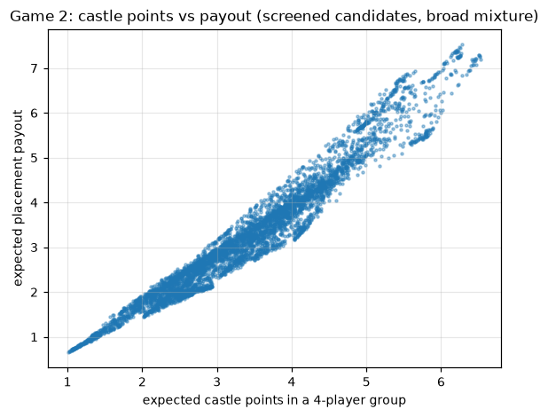

## Supplementary: expected vs robust trade-off and artifact checks

Produced by `scripts/supplementary.py` on the same holdout populations.

### Game 1 exact Pareto frontier: best mean for each worst-case floor (all 7 scenarios)

Computed over all 4,598,126 allocations.

| allocation | mean over scenarios | worst scenario |
|---|---|---|
| [1, 1, 22, 35, 41] | 9.180 | 7.342 |
| [1, 2, 22, 33, 42] | 9.147 | 7.477 |
| [2, 2, 1, 44, 51] | 9.067 | 8.553 |
| [1, 2, 1, 44, 52] | 9.054 | 8.682 |
| [2, 3, 5, 37, 53] | 9.051 | 8.785 |
| [2, 2, 5, 36, 55] | 8.982 | 8.820 |

### Game 1 exact Pareto frontier: best mean for each worst-case floor (6 scenarios, excluding the adversarial one (which is built against our own finalists))

Computed over all 4,598,126 allocations.

| allocation | mean over scenarios | worst scenario |
|---|---|---|
| [1, 1, 22, 35, 41] | 9.486 | 7.363 |
| [1, 1, 21, 35, 42] | 9.447 | 7.513 |
| [1, 15, 1, 37, 46] | 9.377 | 8.730 |
| [1, 14, 1, 38, 46] | 9.341 | 8.808 |
| [1, 13, 1, 38, 47] | 9.292 | 8.868 |
| [1, 12, 1, 40, 46] | 9.259 | 9.041 |
| [1, 9, 2, 42, 46] | 9.133 | 9.110 |

### Game 2: do the finalists rely on exact opponent soldier counts?

Every holdout opponent gets 6 random single-soldier moves (which blurs spikes at specific counts such as 40 or 60), then each candidate is re-scored on 200,000 groups per scenario.

| allocation | mean (raw) | worst (raw) | balanced (raw) | mean (smoothed) | worst (smoothed) | balanced (smoothed) |
|---|---|---|---|---|---|---|
| [0, 0, 38, 62, 0] | 7.111 | 5.955 | 6.533 | 7.120 | 5.961 | 6.541 |
| [0, 0, 39, 61, 0] | 7.220 | 5.851 | 6.536 | 7.196 | 5.835 | 6.515 |
| [0, 1, 37, 62, 0] | 7.021 | 5.870 | 6.446 | 7.014 | 5.885 | 6.450 |
| [0, 0, 28, 0, 72] | 7.153 | 5.623 | 6.388 | 7.138 | 5.609 | 6.374 |
| [0, 0, 40, 60, 0] | 7.189 | 5.430 | 6.309 | 7.185 | 5.512 | 6.349 |
| [1, 2, 35, 62, 0] | 6.935 | 5.924 | 6.430 | 6.862 | 5.824 | 6.343 |
| [0, 0, 40, 0, 60] | 6.816 | 4.493 | 5.655 | 6.874 | 4.681 | 5.777 |

## Run log: what was executed

Mode **full**, finished 2026-10-28 17:19:19, total 405.9 s, peak memory 1125.9 MB, Python 3.12.0, NumPy 2.5.4, macOS-27.0.1-arm64-arm-64bit.

Simulation sizes: pop_size=10000, n_random_candidates=5000, g2_screen_groups=20000, g2_validate_groups=200000, evo_generations=60, evo_pop=200, evo_restarts=4, selfplay_iters=40, seeds=[11, 23, 37], master_seed=2026, n_finalists=25, sensitivity_draws=200

| stage | seconds | peak MB (process) | completed |
|---|---|---|---|
| G1 pools | 9.44 | 420.3 | yes |
| G1 baseline tournament | 0.0 | 420.3 | yes |
| G1 scenarios + per-scenario optimization | 3.18 | 435.9 | yes |
| G1 exhaustive robust search + iterative adversarial scenario | 18.31 | 764.8 | yes |
| G1 holdout validation + robustness | 1.89 | 764.8 | yes |
| G1 seed stability | 11.88 | 764.8 | yes |
| G1 self-play | 0.05 | 764.8 | yes |
| G1 strategic analysis | 1.8 | 810.2 | yes |
| G2 pools | 21.38 | 810.2 | yes |
| G2 baseline tournament | 0.04 | 810.2 | yes |
| G2 scenarios + per-scenario optimization | 229.25 | 810.2 | yes |
| G2 screening set for strategic analysis | 17.6 | 958.1 | yes |
| G2 robust optimization + iterative adversarial scenario | 24.96 | 984.6 | yes |
| G2 holdout validation (screen all candidates) | 15.32 | 1048.6 | yes |
| G2 finalist validation (fresh groups, paired CRN) | 21.26 | 1125.9 | yes |
| G2 targeted exploitability of top finalists | 4.43 | 1125.9 | yes |
| G2 seed stability | 2.24 | 1125.9 | yes |
| G2 self-play | 22.36 | 1125.9 | yes |
| G2 strategic analysis | 0.42 | 1125.9 | yes |
